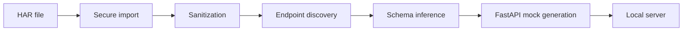

# VOAI-GhostAPI

Capture behavior. Reconstruct APIs. Develop offline.

VOAI-GhostAPI transforms authorized HTTP Archive (HAR 1.2) captures into sanitized, locally runnable FastAPI mock backends. It lets development continue when a remote API is unavailable, unstable, costly, or unsuitable for local testing.

## What is VOAI-GhostAPI?

An offline-first Python tool that imports observations, removes secrets, infers stable endpoint patterns, persists a versioned workspace, and generates deterministic FastAPI fixtures.

## Why VOAI-GhostAPI?

It keeps captured behavior available without contacting the original service. Input is preserved by the caller; imported workspaces contain only sanitized data.

## Features

- HAR 1.2 parsing with size and entry limits
- Stable redaction of credentials, cookies, tokens, and sensitive fields
- Deterministic endpoint and JSON shape inference
- Standalone FastAPI generation with OpenAPI and `/docs`
- Rich CLI and offline operation

## How It Works



## Requirements

Python 3.11+.

## Installation

```bash
python -m pip install .
```

For a Windows development checkout, create and activate a virtual environment:

```powershell
cd path\to\VOAI-GhostAPI
python -m venv .venv
.venv\Scripts\Activate.ps1
python -m pip install -e ".[dev]"
voai-ghostapi --help
voai-ghostapi --version
```

## Quick Start

```powershell
voai-ghostapi import capture.har --output ./workspace
voai-ghostapi inspect ./workspace
voai-ghostapi validate ./workspace
voai-ghostapi generate ./workspace --output ./generated
voai-ghostapi serve ./generated --port 8000
```

To preview and remove recognized generated artifacts beneath the current directory:

```text
voai-ghostapi clean --all --dry-run
voai-ghostapi clean --all
voai-ghostapi clean --all --yes
```

Cleanup only considers recognized `workspace`, `workspace-new`, `workspace-fixed`,
`generated`, `generated-new`, and `generated-fixed` directories. It requires VOAI
markers and skips directories containing unexpected files. HAR captures, virtual
environments, source files, and unrelated files are protected. Stop any running
mock server before cleaning its generated directory.

The import command expects a HAR file in the current project folder. For example, save an authorized browser capture as `capture.har`, then run the commands above. Open `http://127.0.0.1:8000/docs` to explore the generated mock.

## Website and Combined Extraction

The original HAR workflow remains network-free:

```powershell
voai-ghostapi import capture.har --output ./workspace
```

For bounded website extraction, use explicit confirmation or `--yes` for automation:

```powershell
voai-ghostapi extract --url https://example.com --scope page --resources html,css,js --yes
voai-ghostapi extract --url https://example.com --scope page --resources html,css,js,images,svg,fonts,json,video,audio,documents --yes
voai-ghostapi extract --url https://example.com --scope page --resources all --snapshot --yes
voai-ghostapi extract --url https://example.com --scope selected --pages /docs,/pricing --yes
voai-ghostapi extract --url https://example.com --scope site --max-pages 20 --max-depth 2 --snapshot --yes
voai-ghostapi extract --url https://example.com --scope site --resume --yes
voai-ghostapi extract --url https://example.com --har capture.har --output ./extracted --yes
voai-ghostapi extract --url https://example.com --interactive --yes
voai-ghostapi extract --url https://example.com --interactive --storage-state state.json --interactions interactions.json --yes
voai-ghostapi extract --url https://example.com --interactive --manual-login --login-wait-seconds 60 --yes
voai-ghostapi wizard
```

Website output is kept under `website/`; optional snapshots are under `snapshot/`.
The crawler stays on the requested origin, blocks local and private destinations,
and applies page, depth, concurrency, crawl-delay, per-resource, and total-download limits. `--interactive` is an optional browser-backed,
read-only observation pass installed with `pip install .[browser]` and a Playwright browser runtime. It records
observed API/resource responses in `website/interactive.json`; it reports observed traffic only and never claims
complete API discovery. Safe recipes may click navigation, tabs, pagination, expandable sections, fill read-only
filters/search fields, select options, or scroll for infinite-loading content. It never replays state-changing
requests automatically. Unknown and destructive actions require an explicit separate workflow and are rejected by
the automatic observer. Authentication is supported only through a user-provided authorized storage-state file or
the bounded visible `--manual-login` window; passwords and storage-state contents are not persisted.
The crawler reads same-origin XML sitemap sets and nested sitemap indexes, uses breadth-first batches,
normalizes tracking query parameters, and caps query variants per path to prevent pagination loops.
Authorized browser sessions can be supplied with a Playwright storage-state JSON file.
Read-only recipes in a JSON array support `click`, `fill`, `select`, and bounded
`scroll` actions with optional `kind` values (`navigation`, `tab`, `filter`, `search`,
`pagination`, `infinite-scroll`, or `expand`); each observed response records the triggering
interaction, request parameters/body shape, response sample, source page, status, and MIME type.
Unknown or state-changing actions are rejected. Interactive runs are bounded by interaction count,
time, memory, response size, and observation count.

Resource selection accepts `html`, `css`, `js`, `images`, `svg`, `fonts`, `json`,
`manifests`, `icons`, `video`, `audio`, `documents`, and `all`. External and inline
CSS, JavaScript, and JSON-LD are recorded when their resource class is selected.
Every fetched resource is recorded in
`website/extraction.json` with its URL, source page, MIME type, status, size, SHA-256
checksum, and local path when it was selected for download. Identical content is
stored once by checksum. Snapshot rewriting covers HTML attributes, CSS `url(...)`,
and JavaScript `fetch(...)`/`import(...)` references when the target was downloaded.
Use `--max-resource-mb`, `--max-total-mb`, `--max-resources`, and `--max-seconds`
to bound individual files, aggregate bytes, resource count, and extraction time.
Use `clear` to explicitly select no downloadable website resources. HAR inputs are
prevalidated before confirmation and persistent workspace creation. Combined runs
keep website resources under `website/` and mark exact duplicate observations from
both pipelines with source `both`.

To preview a generated snapshot locally:

```powershell
voai-ghostapi preview ./extracted/snapshot --port 8001
```

Snapshots are separate from the generated FastAPI mock. `snapshot/snapshot.json`
records copied files, original-URL-to-local-path mappings, unresolved references,
and limitations. Only resources that were actually downloaded are rewritten;
authentication, server-rendered behavior, live APIs, and third-party integrations
may need additional services when previewed offline.

## CLI Commands

`import` sanitizes a HAR into a workspace; `inspect` summarizes observations; `validate` checks its version and records; `generate` writes a runnable app; `serve` runs it on `127.0.0.1`.

## Example Workflow

Export a synthetic or authorized capture, import it, inspect the discovered methods, validate the workspace, generate fixtures, then browse `http://127.0.0.1:8000/docs`.

## Security and Privacy

Credentials, cookies, bearer tokens, API keys, passwords, and common personal data are replaced before persistence. Original-to-placeholder mappings are never stored. The importer never executes captured content or makes network requests. Automated redaction cannot identify every proprietary secret; review sanitized output before sharing.

## Project Architecture

The `src/voai_ghostapi` package separates models, parsing, sanitization, inference, persistence, generation, runtime, and CLI concerns.

## Supported Formats

HAR 1.2 JSON with textual request and response bodies. Binary, malformed, oversized, and unsupported bodies are skipped safely.

## Current Development Status

The extraction upgrade is implemented as a local feature branch and is testable offline for HAR and HTTP workflows.
The optional Playwright browser runtime and remote CI verification remain environment-dependent.

## Limitations

Mocks replay observed examples and do not infer business logic, state, authentication, or unobserved behavior. Dynamic routes are inferred only for numeric and UUID path segments.

## Development Roadmap

See [docs/ROADMAP.md](docs/ROADMAP.md). Future releases cover stateful scenarios, SDKs, a dashboard, and optional offline AI analysis.

## Contributing

See `CONTRIBUTING.md` for local checks and the contribution process.

## License

MIT.
