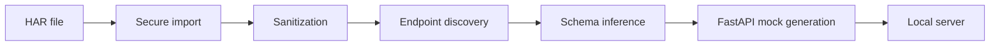

# VOAI-GhostAPI

Capture behavior. Reconstruct APIs. Develop offline.

VOAI-GhostAPI transforms authorized HTTP Archive (HAR 1.2) captures into sanitized, locally runnable FastAPI mock backends. It lets development continue when a remote API is unavailable, unstable, costly, or unsuitable for local testing.

## What is VOAI-GhostAPI?

An offline-first Python tool that imports observations, removes secrets, infers stable endpoint patterns, persists a versioned workspace, and generates deterministic FastAPI fixtures.

## Why VOAI-GhostAPI?

It keeps captured behavior available without contacting the original service. Input is preserved by the caller; imported workspaces contain only sanitized data.

## Features

- HAR 1.2 parsing with size and entry limits
- Stable redaction of credentials, cookies, tokens, and sensitive fields
- Deterministic endpoint and JSON shape inference
- Standalone FastAPI generation with OpenAPI and `/docs`
- Rich CLI and offline operation

## How It Works



## Requirements

Python 3.11 or 3.12. These are the versions covered by the CI matrix. Python
3.13 and newer are not currently supported because the compiled dependency
set is not verified on those interpreters.

## Installation

```bash
python -m pip install .
```

For a Windows development checkout in PowerShell, create and activate a virtual
environment with the Windows activation script:

```powershell
cd path\to\VOAI-GhostAPI
py -3.12 -m venv .venv-new
.\.venv-new\Scripts\Activate.ps1
# Verify that both Python and pip come from this environment.
python -c "import sys; print(sys.executable)"
python -m pip --version
python -m pip install -e ".[dev]"
voai-ghostapi --help
voai-ghostapi --version
```

In Git Bash on Windows, use the Bash activation script and the Python launcher:

```bash
cd /path/to/VOAI-GhostAPI
py -3.12 -m venv .venv-new
. .venv-new/Scripts/activate
# Verify that the active interpreter is the new environment before continuing.
python -c 'import sys; print(sys.executable)'
python -m pip --version
python -m pip install -e '.[dev]'
voai-ghostapi --help
voai-ghostapi --version
```

On Linux or macOS, use the versioned interpreter and the `bin` activation
directory instead:

```bash
cd /path/to/VOAI-GhostAPI
python3.12 -m venv .venv-new
. .venv-new/bin/activate
python -c 'import sys; print(sys.executable)'
python -m pip --version
python -m pip install -e '.[dev]'
voai-ghostapi --help
voai-ghostapi --version
```

The verification commands should show a path containing `.venv-new`. If they
show a system Python, activate the environment again before installing or
running the CLI.

## Quick Start

### Extraction Studio

Launch the local graphical interface on `127.0.0.1`:

```powershell
voai-ghostapi studio --open
```

The Studio is a thin FastAPI layer over the same Python extraction engine. It
provides a three-mode confirmation wizard, live job metrics, project/resource
browsing, API inspection, offline snapshot preview, and an explicitly confirmed
project-delete action. It does not require
Node.js at runtime and never binds beyond localhost. The CLI remains fully
usable without the Studio.

The dashboard accepts HAR files through its local file picker. Website and
combined jobs still enforce the crawler's URL, size, robots, and output-path
protections. Interactive discovery is optional and only observes traffic from
authorized, read-only browser sessions.

```powershell
voai-ghostapi import capture.har --output ./workspace
voai-ghostapi inspect ./workspace
voai-ghostapi validate ./workspace
voai-ghostapi generate ./workspace --output ./generated
voai-ghostapi serve ./generated --port 8000
```

The same HAR workflow in Bash is:

```bash
voai-ghostapi import capture.har --output ./workspace
voai-ghostapi inspect ./workspace
voai-ghostapi validate ./workspace
voai-ghostapi generate ./workspace --output ./generated
voai-ghostapi serve ./generated --port 8000
```

To preview and remove recognized generated artifacts beneath the current directory:

```text
voai-ghostapi clean --all --dry-run
voai-ghostapi clean --all
voai-ghostapi clean --all --yes
```

Cleanup only considers recognized `workspace`, `workspace-new`, `workspace-fixed`,
`generated`, `generated-new`, and `generated-fixed` directories. It requires VOAI
markers and skips directories containing unexpected files. HAR captures, virtual
environments, source files, and unrelated files are protected. Stop any running
mock server before cleaning its generated directory.

Website and combined extraction use `./extracted` by default and require that
directory to be empty before starting. The cleanup command intentionally does
not remove `extracted` because it is a general extraction result, not a
recognized workspace or generated mock artifact. To preserve the existing
result, choose another output directory:

```bash
voai-ghostapi extract --url https://example.com --output ./extracted-next
```

To remove the old result after checking the path, use the command for your
shell:

```powershell
Remove-Item -LiteralPath .\extracted -Recurse -Force
```

```bash
rm -rf -- ./extracted
```

These deletion commands are intentionally explicit; verify the directory is
the disposable extraction output before running them.

The import command expects a HAR file in the current project folder. For example, save an authorized browser capture as `capture.har`, then run the commands above. Open `http://127.0.0.1:8000/docs` to explore the generated mock.

## Extraction modes

The original HAR-to-FastAPI workflow remains the smallest and most predictable
workflow. It never contacts the captured website:

```powershell
voai-ghostapi import capture.har --output ./workspace
voai-ghostapi inspect ./workspace
voai-ghostapi validate ./workspace
voai-ghostapi generate ./workspace --output ./generated
voai-ghostapi serve ./generated --port 8000
```

The `import` command accepts HAR 1.2 JSON and can be used with the existing
workspace, inspection, validation, generation, and local serving commands.
Credentials and other sensitive values are sanitized before the workspace is
written. Multiple captures are supported by repeating `--har` with `extract`.

### Website URL extraction

Use `extract --url` when the source is an authorized website. The default
`page` scope fetches one page and its selected resource references. `site` uses
bounded breadth-first crawling of same-origin pages, while `selected` processes
only the paths supplied with `--pages`:

For bounded website extraction, use explicit confirmation or `--yes` for automation:

```powershell
voai-ghostapi extract --url https://example.com --scope page --resources html,css,js --yes
voai-ghostapi extract --url https://example.com --scope page --resources html,css,js,images,svg,fonts,json,video,audio,documents --yes
voai-ghostapi extract --url https://example.com --scope page --resources all --snapshot --yes
voai-ghostapi extract --url https://example.com --scope selected --pages /docs,/pricing --yes
voai-ghostapi extract --url https://example.com --scope site --max-pages 20 --max-depth 2 --snapshot --yes
voai-ghostapi extract --url https://example.com --scope site --resume --yes
voai-ghostapi extract --url https://example.com --har capture.har --output ./extracted --yes
voai-ghostapi extract --url https://example.com --interactive --yes
voai-ghostapi extract --url https://example.com --interactive --storage-state state.json --interactions interactions.json --yes
voai-ghostapi extract --url https://example.com --interactive --manual-login --login-wait-seconds 60 --yes
voai-ghostapi wizard
```

`--yes` confirms a preflight summary for automation. Without it, the CLI asks
for confirmation before network work begins. `wizard` provides the same mode,
scope, resource, output, and confirmation steps interactively.

### HAR-only extraction

HAR-only extraction remains independent of networking and Playwright:

```powershell
voai-ghostapi extract --har capture.har --output ./extracted --yes
voai-ghostapi extract --har first.har --har second.har --output ./extracted --yes
```

HAR files are validated before confirmation and imported into the same unified
inventory used by website extraction. The generated mock is deterministic and
works offline.

### Combined extraction

Provide both inputs to merge captured traffic with a bounded website crawl:

```powershell
voai-ghostapi extract --url https://example.com --har capture.har `
  --scope site --max-pages 20 --max-depth 2 --output ./extracted --yes
```

Equivalent observations are deduplicated, distinct status or response variants
are retained, and provenance is recorded as `har`, `website`, or `both`.
Website resources remain under `website/`; API observations are persisted under
`workspace/` and can be sent to the normal `generate` command.

All one-line commands in this section work in either shell. For a multiline
command, PowerShell uses a backtick while Bash uses a trailing backslash:

```bash
voai-ghostapi extract --url https://example.com --har capture.har \
  --scope site --max-pages 20 --max-depth 2 --output ./extracted --yes
```

## Crawling, resources, and limits

`page` and `site` are deliberately different scopes: page scope sets one page
and depth zero; site scope follows bounded same-origin links and sitemap URLs.
`selected` accepts comma-separated paths and does not follow unrelated links.
The crawler normalizes URLs, caps query variants, follows safe same-origin
redirects, reads nested XML sitemaps, applies robots rules, and uses bounded
concurrency with retry backoff. It records failures and continues where it can.

Select resources with `--resources` (comma-separated): `html`, `css`, `js`,
`images`, `svg`, `fonts`, `json`, `manifests`, `icons`, `video`, `audio`,
`documents`, or `all`. Use `clear` for no downloadable website resources.
Inline CSS, JavaScript, and JSON-LD are recorded when their resource class is
selected. Files are deduplicated by SHA-256 and tracked in
`website/extraction.json` with source URL, source page, MIME type, status, size,
checksum, and local path.

Bound the run with `--max-pages`, `--max-depth`, `--concurrency`,
`--crawl-delay`, `--max-resources`, `--max-resource-mb`, `--max-total-mb`, and
`--max-seconds`. `--resume` uses the checkpoint retained after cancellation.
Large runs display a time, disk, and accessibility warning; automated runs over
the configured threshold also require `--confirm-large`.

The Rich dashboard reports the current stage, current page, discovered,
completed, skipped, failed, resource, API, byte, pending, and elapsed-time
counters. It does not display a percentage when the total is unknown. Each
run writes `extraction-report.json` with page outcomes, API totals, byte totals,
warnings, and coverage limitations.

## Interactive API discovery

`--interactive` enables an optional Playwright pass that observes requests and
responses triggered by a permitted page load or bounded read-only recipes:

```powershell
python -m pip install ".[browser]"
playwright install chromium
voai-ghostapi extract --url https://example.com --interactive `
  --storage-state state.json --interactions interactions.json --yes
```

Recipes can click navigation, tabs, pagination, and expandable sections; fill
read-only search or filter inputs; select options; and scroll for bounded
infinite-loading content. Unknown and state-changing actions are rejected.
Interactive output is written to `website/interactive.json` and reports only
observed traffic; it does not claim complete API discovery.

Authentication is limited to an authorized Playwright storage-state file or a
visible `--manual-login` session. Do not provide passwords to the CLI. Cookies,
authorization headers, browser storage, and session tokens are not persisted.

## Offline website snapshots

Add `--snapshot` to copy downloaded website files into a separate local
snapshot:

```powershell
voai-ghostapi extract --url https://example.com --scope page `
  --resources all --snapshot --yes
voai-ghostapi preview ./extracted/snapshot --port 8001
```

The snapshot manifest maps original URLs to local paths and lists unresolved
references and limitations. HTML attributes, CSS `url(...)`, and recognized
JavaScript `fetch(...)`/`import(...)` references are rewritten when the target
was downloaded. Authentication, server-side rendering, live APIs, third-party
integrations, and resources blocked by limits or origin policy may not work
offline. Snapshots are separate from generated FastAPI mocks.

## Output layout

Website and combined runs use this layout:

```text
extracted/
├── extraction-report.json
├── website/
│   ├── extraction.json
│   ├── checkpoint.json
│   ├── interactive.json          # when --interactive is enabled
│   └── resources/
├── workspace/
│   └── workspace.json             # when API observations exist
└── snapshot/                      # when --snapshot is enabled
    └── snapshot.json
```

The generated FastAPI application remains a separate directory selected with
`generate --output`. Existing generated output is never overwritten unless it
is empty or explicitly removed with the safety-checked `clean` command.

## CLI Commands

`import` sanitizes a HAR into a workspace; `inspect` summarizes observations; `validate` checks its version and records; `generate` writes a runnable app; `serve` runs it on `127.0.0.1`.

## Example Workflow

Export a synthetic or authorized capture, import it, inspect the discovered methods, validate the workspace, generate fixtures, then browse `http://127.0.0.1:8000/docs`.

## Security and Privacy

Credentials, cookies, bearer tokens, API keys, passwords, and common personal data are replaced before persistence. Original-to-placeholder mappings are never stored. The importer never executes captured content or makes network requests. Automated redaction cannot identify every proprietary secret; review sanitized output before sharing.

## Project Architecture

The `src/voai_ghostapi` package separates models, parsing, sanitization, inference, persistence, generation, runtime, and CLI concerns.

## Supported Formats

HAR 1.2 JSON with textual request and response bodies. Binary, malformed, oversized, and unsupported bodies are skipped safely.

## Current Development Status

The extraction upgrade is implemented as a local feature branch and is testable offline for HAR and HTTP workflows.
The optional Playwright browser runtime and remote CI verification remain environment-dependent.

## Limitations

Mocks replay observed examples and do not infer business logic, state, authentication, or unobserved behavior. Dynamic routes are inferred only for numeric and UUID path segments.

## Development Roadmap

See [docs/ROADMAP.md](docs/ROADMAP.md). Future releases cover stateful scenarios, SDKs, a dashboard, and optional offline AI analysis.

## Contributing

See `CONTRIBUTING.md` for local checks and the contribution process.

## License

MIT.
