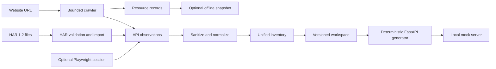

# Architecture

VOAI-GhostAPI preserves the original offline HAR-to-FastAPI pipeline and feeds
website extraction into the same observation model. The three input modes are
independent at the edges and converge only at inventory construction:

`core.py` owns the Pydantic models, sanitization, route normalization, schema
inference and merging, workspace persistence, validation, and deterministic
FastAPI source generation. Observations retain method, normalized path, status,
response shape, and provenance (`har`, `website`, or `both`). Equivalent
observations are deduplicated while distinct status or response variants remain
available to the generator.

`extract.py` owns the website pipeline. It validates the starting origin and
redirect destinations, blocks localhost/private/link-local/metadata targets,
normalizes URLs, reads nested XML sitemaps, follows same-origin links in bounded
breadth-first batches, applies robots rules and crawl delay, retries transient
failures, and enforces page, depth, concurrency, time, resource-count, and byte
limits. It records successful, failed, skipped, and pending pages and writes a
checkpoint that can be resumed after cancellation.

The crawler parses HTML for navigation and resource references. Downloaded HTML,
CSS, JavaScript, JSON, images, fonts, media, manifests, icons, and documents are
stored under `website/resources/` with content-hash names and metadata in
`website/extraction.json`. Resource references are not treated as executable
source; downloaded JavaScript is preserved as an asset and is never interpreted
as backend code by the extractor.

`interactive.py` is an optional Playwright adapter. It uses one bounded browser
context, observes network responses, sanitizes request URLs and bodies, and
accepts only read-only interaction recipes. Navigation, tabs, filters, search,
pagination, expanders, and bounded scrolling can be classified and recorded.
State-changing or destructive actions are rejected. A user-provided authorized
storage-state file or visible manual-login session may be used, but passwords,
cookies, authorization headers, and browser storage are not persisted.

Website files remain under `website/`, API observations and generated inventory
under `workspace/`, and an optional rewritten local copy under `snapshot/`.
`snapshot/snapshot.json` records original-URL mappings, unresolved references,
and limitations. HTML attributes, CSS `url(...)`, and recognized JavaScript
`fetch(...)`/`import(...)` references are rewritten only when the target was
actually downloaded. Snapshot generation is separate from FastAPI mock
generation and cannot reproduce server-side rendering, live backends,
authentication, or third-party integrations that were not captured.

The CLI layer in `cli.py` performs mode selection, preflight validation,
confirmation, progress presentation, and final-report display. It does not
duplicate crawling or schema logic. `import`, `inspect`, `validate`, `generate`,
and `serve` continue to provide the original HAR workflow; `extract` and
`wizard` compose the new modes around the shared pipeline.

Security boundaries are intentional: extraction is authorized by the caller,
never bypasses authentication or access controls, never replays mutating
requests, and never claims complete API discovery. Filesystem writes are kept
under selected output roots, generated output is not overwritten when non-empty,
and persisted workspaces contain sanitized values only.

The optional `studio` command starts `studio.py`, a localhost-only FastAPI
application that wraps the same `extract()` function. Its job API tracks real
progress events, cancellation, and final reports; read-only project endpoints
serve sanitized inventory and downloaded resource metadata for the dashboard.
Packaged static assets keep the installed wheel self-contained, so Node.js is
needed only when changing the UI source. The Studio never exposes arbitrary
filesystem paths, storage-state files, or a public network binding.

